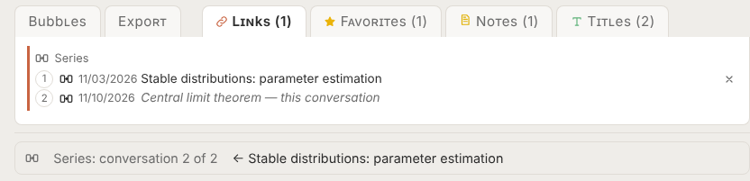

# Claude Export Viewer

[English](README.md) | [Français](README.fr.md) | [Español](README.es.md) | **Deutsch** | [Italiano](README.it.md) | [Português](README.pt.md) | [Nederlands](README.nl.md) | [Polski](README.pl.md) | [Русский](README.ru.md) | [中文](README.zh.md) | [日本語](README.ja.md) | [한국어](README.ko.md)

CEV macht aus dem Export Ihrer Claude.ai-Unterhaltungen eine **lokale Bibliothek**: eine Website, die Sie offline im Browser lesen und in der Sie Ihre Unterhaltungen durchsuchen, mit Anmerkungen versehen, neu ordnen und exportieren können. Jeder neue Export kommt zu den früheren hinzu: Nichts geht verloren, auch nicht, was inzwischen auf claude.ai gelöscht wurde.

> Unabhängiges Projekt, nicht mit Anthropic verbunden. Claude ist eine Marke von Anthropic. Entwickelt und getestet unter Linux (Ubuntu 26.04, Python 3.14); Windows und macOS sollten funktionieren, wurden aber noch nicht ausprobiert. 12 Sprachen.

## Installation

1. Installieren Sie Python 3 und vier Bibliotheken:
   - Ubuntu / Debian: `sudo apt install python3-jinja2 python3-mistune python3-pydantic python3-pygments`
   - Windows (Python 3.11 oder neuer): `py -m pip install jinja2 mistune pydantic pygments`
2. Entpacken Sie `claude-export-viewer.zip` und doppelklicken Sie auf **Installer CEV** (`.sh` unter Linux, `.cmd` unter Windows, `.command` unter macOS).

Das Programm wird in `~/claude-export-viewer` abgelegt und erstellt das Symbol **Claude-Bibliothek**. Ein Update geht genauso, mit dem neuen ZIP: Ihre Unterhaltungen werden nie angetastet.

## Erster Import

1. Auf claude.ai (Website oder Desktop-App; nicht in den Mobil-Apps): **Einstellungen > Datenschutz > Daten exportieren**. Eine E-Mail kommt mit einem Link, 24 Stunden gültig, der eine kleine „Manifest“-Datei herunterlädt.
2. Öffnen Sie die **Claude-Bibliothek** über ihr Symbol. Klicken Sie im Reiter **Datenverwaltung** auf den Rahmen **Export importieren**: CEV öffnet die Links des Exports nacheinander in Ihrem Browser, importiert alles und zeigt Ihre Unterhaltungen.

Wiederholen Sie das ab und zu: Neue Exporte ergänzen das Archiv.

## Die Bibliothek: zwei Teile

Die Bibliothek hat zwei Teile: das **Inhaltsverzeichnis**, das alle Ihre Unterhaltungen auflistet, und die Seite jeder **Unterhaltung**.

## Das Inhaltsverzeichnis

Oben die Sprache, dann drei Reiter; immer nur einer ist geöffnet, ein Klick auf den geöffneten Reiter schließt ihn.

**Überblick**: die Zahl der Unterhaltungen, Nachrichten und Tokens, die Größe der Website und die Aktivität Woche für Woche. **Ein Klick auf einen Balken filtert die Liste auf diese Woche.** Die Kachel der Größe wird farbig, wenn eine Sicherung empfohlen ist; ein Klick führt dann zur Schaltfläche **Bibliothek sichern**.

**Datenverwaltung**: der Import, dann die Werkzeuge der Bibliothek. **Rubriken verwalten** (umbenennen, zusammenführen, löschen); **Bibliothek sichern** in ein datiertes ZIP; **Alles exportieren** als Markdown, lesbar ohne CEV; **Speicherplatz freigeben** (nicht mehr benötigte Dateien); **Anmerkungen wiederherstellen** (CEV bewahrt die letzten 5 Stände Ihrer Anmerkungen); **Archiv prüfen** (und eine beschädigte Unterhaltung aus den aufbewahrten Exporten reparieren); **Deinstallieren**, nachdem Kopien von allem angeboten wurden.

**Filter**: Suche in den Titeln und im Inhalt (Text, Formeln: `\alpha` oder `α`), mit einer Zahl **erlaubter Tippfehler**; Rubrik, Zeitraum und Sortierung.

**Die Liste**: jede Unterhaltung mit Datum, Größe und Anmerkungen (Favoriten, Verknüpfungen, Notizen). Das Menü rechts gibt ihr eine **Rubrik**. Um zwei Unterhaltungen zu **verknüpfen**, ziehen Sie die eine auf die andere.

## Die Unterhaltung

Oben: der Titel, rechts daneben die **Ansicht** (Lesen oder Struktur). Darunter Reiter, die anfangs geschlossen sind; immer nur einer ist geöffnet, ein Klick auf den geöffneten Reiter schließt ihn.

- **Sprechblasen**: **Ausblenden** entlastet den Bildschirm (Ressourcen der KI, Notizen, Titel, Nummern, andere Versionen und Löschungen); **Anzeige** kürzt jede Sprechblase auf 1, 3 oder 5 Zeilen; **Stimmen** wählt die Stimmen für das Vorlesen. Ihre Auswahl bleibt von einer Unterhaltung zur nächsten erhalten.
- **Exportieren**: eine Datei .md, .odt, .docx, .txt oder .pdf, mit oder ohne Ihre Anmerkungen und die anderen Versionen, auf Wunsch als ZIP.
- **Verknüpfungen**, **Favoriten**, **Notizen** und **Titel** der Seite: ein Klick führt dorthin.

**Die Sprechblasen** werden wie auf claude.ai dargestellt: Markdown, farbiger Code mit Kopieren-Schaltfläche, mathematische Formeln, Artefakte (Claudes Programme laufen in der Seite, offline), vollständige angehängte Dokumente.

- Nach dem Datum die Symbole der Sprechblase: **Favorit**, **Notiz**, **Titel**, kopieren, diese Nachricht exportieren, das Auge (bei Ihren Nachrichten: Claudes Antwort zeigen oder ausblenden), **vorlesen**.
- Vor dem Namen der Platz der Sprechblase in der Unterhaltung: `1 ← 2 → 2.1 3` = Frage 2 folgt auf 1, hat eine andere Antwort (2.1) und wird von 3 gefolgt. Ein Klick auf eine Marke führt dorthin.
- **Andere Version**: Wenn eine Nachricht bearbeitet oder eine Antwort neu erzeugt wurde, bleiben die anderen Versionen in diesen Rahmen an ihrem Platz lesbar.
- **Hervorhebung** in 5 Farben: Markieren Sie eine Stelle, dann den Stift, der daneben erscheint (oder die Schaltfläche rechts).

Eine sehr lange Unterhaltung wird auf mehrere Seiten verteilt („Teil 2 von 5“), ohne je eine Frage von ihrer Antwort zu trennen; die Suche in der Seite, die Struktur und der Export betreffen dann den angezeigten Teil.

**Die Struktur** zeigt das Schema der Unterhaltung: nummerierte Fragen, Versionen als Zweige. Ein Klick zeigt eine Frage mit allen ihren Antworten. Sie können die **logische Reihenfolge umordnen** (eine Frage hinter eine Antwort ziehen, einen Zweig abtrennen, eine grüne logische Verbindung ziehen), ohne die tatsächliche Reihenfolge zu ändern; „Reihenfolge: tatsächlich · logisch“ in der Leiste der Struktur wechselt zwischen beiden.

**Reihen**: Wenn eine Unterhaltung in einer anderen weitergeht, öffnen Sie den Reiter **Verknüpfungen** und ziehen Sie die verknüpften Unterhaltungen in die gewünschte Reihenfolge. Jede Seite der Reihe zeigt dann „← vorherige · nächste →“, oben und unten.

**Die Schaltflächen rechts**, in zwei Rahmen. Oben: Hervorhebung (das Mausrad wählt die Farbe), zurück zum Inhaltsverzeichnis, Suche in der Unterhaltung, alle Antworten von Claude ausblenden oder zeigen, Hintergrundmusik, helles oder dunkles Design, vorherige oder nächste Seite (‹ ›). Unten: Ihre vorherige oder nächste Nachricht, das Vorlesen der ganzen Unterhaltung, der **langsame Bildlauf** (Geschwindigkeit mit dem Mausrad), Anfang, Mitte und Ende der Seite. Das Inhaltsverzeichnis hat dieselben Schaltflächen, außer denen, die nur eine Unterhaltung betreffen.

Das **Vorlesen** nutzt natürliche Offline-Stimmen ([Piper](https://github.com/OHF-Voice/piper1-gpl)), die beim ersten Gebrauch mit Ihrer Zustimmung installiert werden: eine Stimme für Sie, eine für Claude und die Stimme der Sprache jedes Absatzes.

 

## Ihre Daten

Alles Wichtige liegt in **`~/claude_site/archive/`**: Ihre Unterhaltungen, die ursprünglichen Exporte, Ihre Anmerkungen und Ihre Einstellungen. Eine auf claude.ai gelöschte Unterhaltung bleibt dort, markiert mit „Auf claude.ai gelöscht“. Zum Sichern verwenden Sie **Bibliothek sichern** oder kopieren diesen Ordner; um alles wiederherzustellen, legen Sie die Sicherung auf einer leeren Bibliothek ab.

## Kommandozeile

Alles gibt es auch im Terminal (`python3 claude-export-viewer.py`, `py` unter Windows); `--help` gibt die vollständige Liste.

| Befehl | Wirkung |
| --- | --- |
| `~/Downloads -o ~/claude_site` | importiert den neuesten Export des Ordners |
| `-o ~/claude_site --serve` | öffnet die Bibliothek |
| `--odt "Titel"`, `--docx "Titel"` | exportiert eine Unterhaltung |
| `--export-all` | alle Unterhaltungen als Markdown |
| `--verify`, `--repair` | prüft das Archiv, repariert, was möglich ist |
| `--uninstall`, `--restore ZIP` | deinstalliert, stellt eine Sicherung wieder her |

## Ergänzungen und Lizenz

CEV ist aus dem [claude-export-viewer](https://github.com/lordjabez/claude-export-viewer) von Judson Neer hervorgegangen, dem wir danken; es wurde seitdem tiefgreifend umgestaltet und erweitert.

- **Pandoc** für die Exporte .odt und .docx: `sudo apt install pandoc` (Windows: `winget install --exact --id JohnMacFarlane.Pandoc`; macOS: `brew install pandoc`).
- **Piper** für das Vorlesen: von CEV beim ersten Gebrauch angeboten (etwa 200 MB, dazu 60 MB pro Stimme).

Freie Software unter der **MIT-Lizenz** (Datei `LICENSE`), ohne Gewähr. Enthalten: KaTeX (MIT). Auf Ihren Wunsch separat installiert: Piper (GPL-3). Tests: `python3 -m pytest tests/`.
