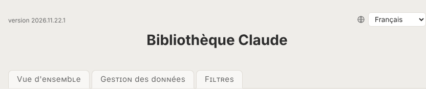
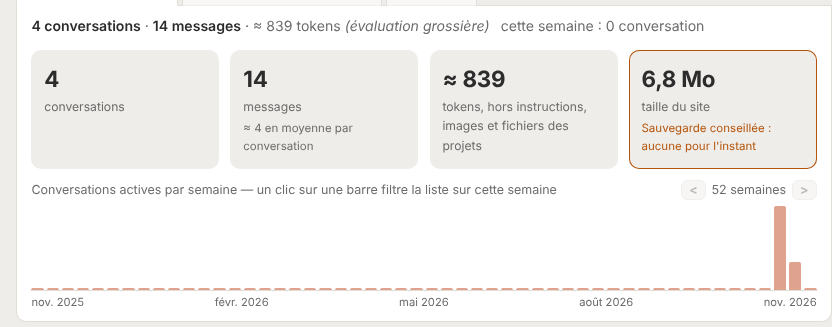
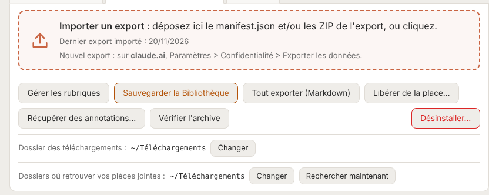
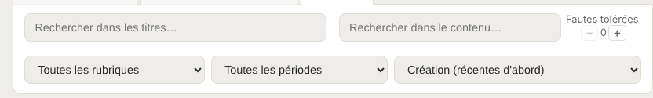
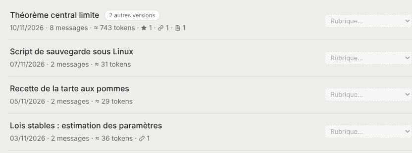
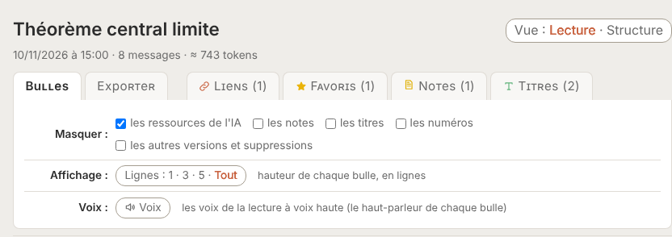
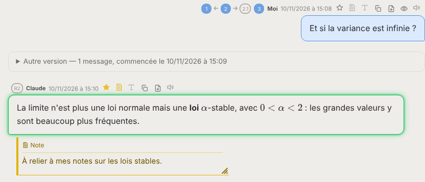
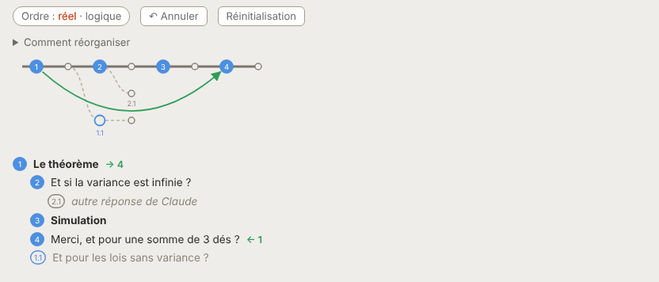
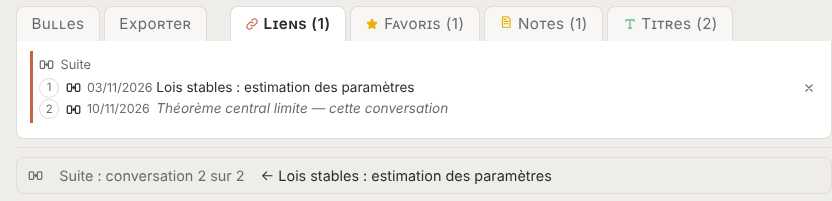

# Claude Export Viewer

[English](README.md) | **Français** | [Español](README.es.md) | [Deutsch](README.de.md) | [Italiano](README.it.md) | [Português](README.pt.md) | [Nederlands](README.nl.md) | [Polski](README.pl.md) | [Русский](README.ru.md) | [中文](README.zh.md) | [日本語](README.ja.md) | [한국어](README.ko.md)

CEV transforme l'export de vos conversations Claude.ai en une **bibliothèque locale** : un site lisible dans votre navigateur, sans Internet, où vous pouvez chercher, annoter, réorganiser et exporter vos discussions. Chaque nouvel export s'ajoute aux précédents : rien ne se perd, même ce qui a été supprimé depuis sur claude.ai.

> Projet indépendant, non affilié à Anthropic. Claude est une marque d'Anthropic. Conçu et testé sous Linux (Ubuntu 26.04, Python 3.14) ; Windows et macOS devraient fonctionner mais n'ont pas encore été essayés. 12 langues.

## Installation

1. Installez Python 3 et quatre bibliothèques :
   - Ubuntu / Debian : `sudo apt install python3-jinja2 python3-mistune python3-pydantic python3-pygments`
   - Windows (Python 3.11 ou plus) : `py -m pip install jinja2 mistune pydantic pygments`
2. Décompressez `claude-export-viewer.zip` et double-cliquez sur **Installer CEV** (`.sh` sous Linux, `.cmd` sous Windows, `.command` sous macOS).

Le programme se place dans `~/claude-export-viewer` et crée l'icône **Bibliothèque Claude**. Une mise à jour se fait de la même façon, avec le nouveau ZIP : vos conversations ne sont jamais touchées.

## Premier import

1. Sur claude.ai (site web ou application de bureau ; pas depuis les applications mobiles) : **Paramètres > Confidentialité > Exporter les données**. Un e-mail arrive avec un lien, valable 24 heures, qui télécharge un petit fichier « manifeste ».
2. Ouvrez la **Bibliothèque Claude** par son icône. Dans l'onglet **Gestion des données**, cliquez sur le cadre **Importer un export** : CEV ouvre les liens de l'export un par un dans votre navigateur, importe tout et affiche vos conversations.

Recommencez de temps en temps : les nouveaux exports complètent l'archive.

## La Bibliothèque : deux parties

La Bibliothèque a deux parties : le **Sommaire**, qui liste toutes vos conversations, et la **Discussion**, la page de chaque conversation.

## Le Sommaire

En haut, la langue, puis trois onglets ; un seul est ouvert à la fois, un clic sur l'onglet ouvert le referme.

**Vue d'ensemble** : le nombre de conversations, de messages et de tokens, la taille du site, et l'activité semaine par semaine. **Un clic sur une barre filtre la liste sur cette semaine.** La tuile de la taille passe en couleur quand une sauvegarde est conseillée ; un clic mène alors au bouton **Sauvegarder la Bibliothèque**.

**Gestion des données** : l'import, puis les outils de la bibliothèque. **Gérer les rubriques** (renommer, fusionner, supprimer) ; **Sauvegarder la Bibliothèque** dans un ZIP daté ; **Tout exporter** en Markdown, lisible sans CEV ; **Libérer de la place** (fichiers devenus inutiles) ; **Récupérer des annotations** (CEV garde les 5 derniers états de vos annotations) ; **Vérifier l'archive** (et réparer une conversation abîmée depuis les exports gardés) ; **Désinstaller**, après avoir proposé des copies de tout.

**Filtres** : recherche dans les titres et dans le contenu (texte, formules : `\alpha` ou `α`), avec une **tolérance** aux fautes de frappe ; rubrique, période et tri.

**La liste** : chaque conversation avec sa date, sa taille et ses annotations (favoris, liens, notes). Le menu de droite lui donne une **rubrique**. Pour **lier** deux conversations, glissez l'une sur l'autre.

## La Discussion

En haut : le titre, avec à droite la **Vue** (Lecture ou Structure). Dessous, des onglets fermés au départ ; un seul est ouvert à la fois, un clic sur l'onglet ouvert le referme.

- **Bulles** : **Masquer** allège l'écran (ressources de l'IA, notes, titres, numéros, autres versions et suppressions) ; **Affichage** réduit chaque bulle à 1, 3 ou 5 lignes ; **Voix** choisit les voix de la lecture à voix haute. Vos choix restent d'une discussion à l'autre.
- **Exporter** : un fichier .md, .odt, .docx, .txt ou .pdf, avec ou sans vos annotations et les autres versions, en ZIP si vous le souhaitez.
- **Liens**, **Favoris**, **Notes** et **Titres** de la page : un clic y mène.

**Les bulles** sont rendues comme sur claude.ai : Markdown, code coloré avec bouton Copier, formules mathématiques, artefacts (les programmes de Claude s'exécutent dans la page, hors ligne), documents joints complets.

- Après la date, les icônes de la bulle : **favori**, **note**, **titre**, copier, exporter ce message, l'œil (sur vos messages : afficher ou masquer la réponse de Claude), le **lire à voix haute**.
- Avant le nom, la place de la bulle dans la conversation : `1 ← 2 → 2.1 3` = la question 2 suit la 1, a une autre réponse (2.1) et est suivie de la 3. Un clic sur une pastille y mène.
- **Autre version** : quand un message a été modifié ou une réponse relancée, les autres versions restent lisibles dans ces cadres, à leur place.
- **Surligneur** à 5 couleurs : sélectionnez un passage, puis le stylo qui apparaît à côté (ou le bouton de droite).

Une conversation très longue est montrée en plusieurs pages (« Partie 2 sur 5 »), sans jamais séparer une question de sa réponse ; la recherche dans la page, la Structure et l'export portent alors sur la partie affichée.

**La Structure** montre le schéma de la conversation : questions numérotées, versions en branches. Un clic montre une question avec toutes ses réponses. On peut **réorganiser l'ordre logique** (glisser une question à la suite d'une réponse, couper une branche, tracer un lien logique en vert) sans toucher à l'ordre réel ; « Ordre : réel · logique », dans la barre de la Structure, passe de l'un à l'autre.

**Les suites** : quand une discussion continue dans une autre, ouvrez l'onglet **Liens** et glissez les discussions liées dans l'ordre voulu. Chaque page de la suite affiche alors « ← précédente · suivante → », en haut et en bas.

**Les boutons de droite**, en deux cadres. En haut : surligneur (la molette choisit la couleur), retour au sommaire, recherche dans la conversation, masquer ou afficher toutes les réponses de Claude, musique d'ambiance, thème clair ou sombre, page précédente ou suivante (‹ ›). En bas : votre message précédent ou suivant, la lecture à voix haute de toute la conversation, le **défilement lent** (vitesse à la molette), le haut, le milieu et le bas de la page. Le sommaire a les mêmes boutons, sauf ceux propres à une conversation.

La **lecture à voix haute** utilise des voix naturelles hors ligne ([Piper](https://github.com/OHF-Voice/piper1-gpl)), installées au premier usage avec votre accord : une voix pour vous, une pour Claude, et la voix de la langue de chaque paragraphe.

 

## Vos données

Tout ce qui compte est dans **`~/claude_site/archive/`** : vos conversations, les exports d'origine, vos annotations et vos réglages. Une conversation supprimée sur claude.ai y reste, marquée « supprimée sur claude.ai ». Pour sauvegarder, utilisez **Sauvegarder la Bibliothèque** ou copiez ce dossier ; pour tout remettre, déposez la sauvegarde sur une Bibliothèque vide.

## Ligne de commande

Tout existe aussi dans un terminal (`python3 claude-export-viewer.py`, `py` sous Windows) ; `--help` donne la liste complète.

| Commande | Effet |
| --- | --- |
| `~/Téléchargements -o ~/claude_site` | importe le dernier export du dossier |
| `-o ~/claude_site --serveur` | ouvre la Bibliothèque |
| `--odt "titre"`, `--docx "titre"` | exporte une conversation |
| `--tout-exporter` | toutes les conversations en Markdown |
| `--verifier`, `--reparer` | vérifie l'archive, répare ce qui peut l'être |
| `--desinstaller`, `--restaurer ZIP` | désinstalle, restaure une sauvegarde |

## Compléments et licence

CEV est né du [claude-export-viewer](https://github.com/lordjabez/claude-export-viewer) de Judson Neer, que nous remercions ; il a depuis été profondément transformé et enrichi.

- **Pandoc** pour les exports .odt et .docx : `sudo apt install pandoc` (Windows : `winget install --exact --id JohnMacFarlane.Pandoc` ; macOS : `brew install pandoc`).
- **Piper** pour la lecture à voix haute : proposé par CEV au premier usage (environ 200 Mo, plus 60 Mo par voix).

Logiciel libre sous **licence MIT** (fichier `LICENSE`), fourni sans garantie. Inclus : KaTeX (MIT). Installé à part à votre demande : Piper (GPL-3). Tests : `python3 -m pytest tests/`.
