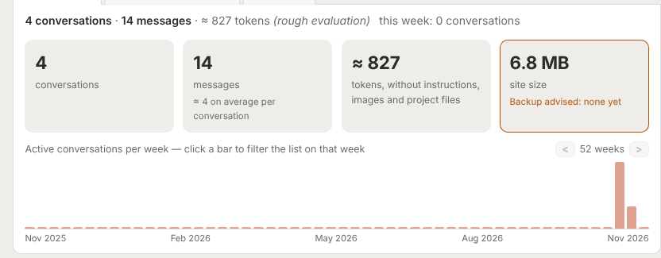
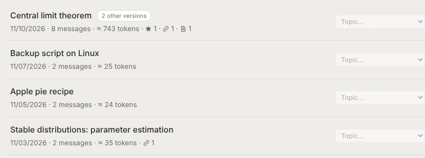

# Claude Export Viewer

[English](README.md) | [Français](README.fr.md) | [Español](README.es.md) | [Deutsch](README.de.md) | **Italiano** | [Português](README.pt.md) | [Nederlands](README.nl.md) | [Polski](README.pl.md) | [Русский](README.ru.md) | [中文](README.zh.md) | [日本語](README.ja.md) | [한국어](README.ko.md)

CEV trasforma l'esportazione delle tue conversazioni di Claude.ai in una **biblioteca locale**: un sito che leggi nel browser, senza Internet, dove puoi cercare, annotare, riorganizzare ed esportare le tue conversazioni. Ogni nuova esportazione si aggiunge alle precedenti: non si perde nulla, nemmeno ciò che nel frattempo è stato eliminato su claude.ai.

> Progetto indipendente, non affiliato ad Anthropic. Claude è un marchio di Anthropic. Progettato e testato su Linux (Ubuntu 26.04, Python 3.14); Windows e macOS dovrebbero funzionare, ma non sono ancora stati provati. 12 lingue.

## Installazione

1. Installa Python 3 e quattro librerie:
   - Ubuntu / Debian: `sudo apt install python3-jinja2 python3-mistune python3-pydantic python3-pygments`
   - Windows (Python 3.11 o successivo): `py -m pip install jinja2 mistune pydantic pygments`
2. Decomprimi `claude-export-viewer.zip` e fai doppio clic su **Installer CEV** (`.sh` su Linux, `.cmd` su Windows, `.command` su macOS).

Il programma si installa in `~/claude-export-viewer` e crea l'icona **Biblioteca Claude**. Un aggiornamento si fa allo stesso modo, con il nuovo ZIP: le tue conversazioni non vengono mai toccate.

## Prima importazione

1. Su claude.ai (sito web o app desktop; non dalle app per dispositivi mobili): **Impostazioni > Privacy > Esporta dati**. Arriva un'e-mail con un link, valido 24 ore, che scarica un piccolo file «manifesto».
2. Apri la **Biblioteca Claude** con la sua icona. Nella scheda **Gestione dei dati**, fai clic sul riquadro **Importa un'esportazione**: CEV apre i link dell'esportazione uno per uno nel browser, importa tutto e mostra le tue conversazioni.

Ripeti di tanto in tanto: le nuove esportazioni completano l'archivio.

## La Biblioteca: due parti

La Biblioteca ha due parti: l'**indice**, che elenca tutte le tue conversazioni, e la pagina di ogni **conversazione**.

## L'indice

In alto, la lingua, poi tre schede; ne è aperta una sola alla volta, e un clic sulla scheda aperta la chiude.

**Panoramica**: il numero di conversazioni, messaggi e token, la dimensione del sito e l'attività settimana per settimana. **Un clic su una barra filtra l'elenco su quella settimana.** Il riquadro della dimensione cambia colore quando è consigliato un salvataggio; un clic porta allora al pulsante **Salva la Biblioteca**.

**Gestione dei dati**: l'importazione, poi gli strumenti della Biblioteca. **Gestisci categorie** (rinominare, unire, eliminare); **Salva la Biblioteca** in uno ZIP datato; **Esporta tutto** in Markdown, leggibile senza CEV; **Libera spazio** (file non più necessari); **Recupera annotazioni** (CEV conserva gli ultimi 5 stati delle tue annotazioni); **Verifica l'archivio** (e ripara una conversazione danneggiata dalle esportazioni conservate); **Disinstalla**, dopo averti proposto copie di tutto.

**Filtri**: ricerca nei titoli e nel contenuto (testo, formule: `\alpha` o `α`), con un numero di **errori tollerati**; categoria, periodo e ordinamento.

**L'elenco**: ogni conversazione con la data, la dimensione e le annotazioni (preferiti, collegamenti, note). Il menu a destra le assegna una **categoria**. Per **collegare** due conversazioni, trascina l'una sull'altra.

## La conversazione

In alto: il titolo, con a destra la **Vista** (Lettura o Struttura). Sotto, schede chiuse all'inizio; ne è aperta una sola alla volta, e un clic sulla scheda aperta la chiude.

- **Visualizzazione**: **Nascondi** alleggerisce lo schermo (risorse dell'IA, note, titoli, numeri, altre versioni ed eliminazioni); **Altezza** riduce ogni messaggio a 1, 3 o 5 righe; **Voci** sceglie le voci della lettura ad alta voce. Le tue scelte restano da una conversazione all'altra.
- **Esporta**: un file .md, .odt, .docx, .txt o .pdf, con o senza le tue annotazioni e le altre versioni, in ZIP se vuoi.
- **Collegamenti**, **Preferiti**, **Note** e **Titoli** della pagina: un clic ti ci porta.

**I messaggi** sono mostrati come su claude.ai: Markdown, codice colorato con pulsante Copia, formule matematiche, artefatti (i programmi di Claude girano nella pagina, offline), documenti allegati completi.

- Dopo la data, le icone del messaggio: **preferito**, **nota**, **titolo**, copia, esporta questo messaggio, l'occhio (sui tuoi messaggi: mostra o nasconde la risposta di Claude), **leggilo ad alta voce**.
- Prima del nome, il posto del messaggio nella conversazione: `1 ← 2 → 2.1 3` = la domanda 2 segue la 1, ha un'altra risposta (2.1) ed è seguita dalla 3. Un clic su un indicatore ti ci porta.
- **Altra versione**: quando un messaggio è stato modificato o una risposta rigenerata, le altre versioni restano leggibili in questi riquadri, al loro posto.
- **Evidenziazione** in 5 colori: seleziona un passaggio, poi la penna che compare accanto (o il pulsante a destra).

Una conversazione molto lunga viene mostrata su più pagine («Parte 2 di 5»), senza mai separare una domanda dalla sua risposta; la ricerca nella pagina, la Struttura e l'esportazione riguardano allora la parte mostrata.

**La Struttura** mostra lo schema della conversazione: domande numerate, versioni come rami. Un clic mostra una domanda con tutte le sue risposte. Puoi **riorganizzare l'ordine logico** (trascinare una domanda dopo una risposta, tagliare un ramo, tracciare un collegamento logico in verde) senza toccare l'ordine reale; «Ordine: reale · logico», nella barra della Struttura, passa dall'uno all'altro.

**Le serie**: quando una conversazione continua in un'altra, apri la scheda **Collegamenti** e trascina le conversazioni collegate nell'ordine voluto. Ogni pagina della serie mostra allora «← precedente · successiva →», in alto e in basso.

**I pulsanti a destra**, in due riquadri. In alto: evidenziazione (la rotellina sceglie il colore), torna all'indice, cerca nella conversazione, nascondi o mostra tutte le risposte di Claude, musica di sottofondo, tema chiaro o scuro, pagina precedente o successiva (‹ ›). In basso: il tuo messaggio precedente o successivo, la lettura ad alta voce di tutta la conversazione, lo **scorrimento lento** (velocità con la rotellina), l'inizio, il centro e la fine della pagina. L'indice ha gli stessi pulsanti, tranne quelli propri di una conversazione.

La **lettura ad alta voce** usa voci naturali offline ([Piper](https://github.com/OHF-Voice/piper1-gpl)), installate al primo uso con il tuo consenso: una voce per te, una per Claude e la voce della lingua di ogni paragrafo.

 

## I tuoi dati

Tutto ciò che conta è in **`~/claude_site/archive/`**: le tue conversazioni, le esportazioni originali, le tue annotazioni e le tue impostazioni. Una conversazione eliminata su claude.ai vi resta, contrassegnata «Eliminata su claude.ai». Per salvare, usa **Salva la Biblioteca** o copia questa cartella; per ripristinare tutto, trascina il salvataggio su una Biblioteca vuota.

## Riga di comando

Tutto esiste anche in un terminale (`python3 claude-export-viewer.py`, `py` su Windows); `--help` dà l'elenco completo.

| Comando | Effetto |
| --- | --- |
| `~/Downloads -o ~/claude_site` | importa l'ultima esportazione della cartella |
| `-o ~/claude_site --serve` | apre la Biblioteca |
| `--odt "titolo"`, `--docx "titolo"` | esporta una conversazione |
| `--export-all` | tutte le conversazioni in Markdown |
| `--verify`, `--repair` | verifica l'archivio, ripara ciò che si può |
| `--uninstall`, `--restore ZIP` | disinstalla, ripristina un salvataggio |

## Complementi e licenza

CEV è nato dal [claude-export-viewer](https://github.com/lordjabez/claude-export-viewer) di Judson Neer, che ringraziamo; da allora è stato profondamente trasformato e arricchito.

- **Pandoc** per le esportazioni .odt e .docx: `sudo apt install pandoc` (Windows: `winget install --exact --id JohnMacFarlane.Pandoc`; macOS: `brew install pandoc`).
- **Piper** per la lettura ad alta voce: proposto da CEV al primo uso (circa 200 MB, più 60 MB per voce).

Software libero con **licenza MIT** (file `LICENSE`), fornito senza garanzia. Incluso: KaTeX (MIT). Installato a parte su tua richiesta: Piper (GPL-3). Test: `python3 -m pytest tests/`.
