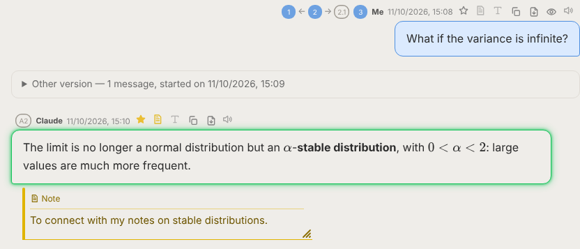

# Claude Export Viewer

[English](README.md) | [Français](README.fr.md) | [Español](README.es.md) | [Deutsch](README.de.md) | [Italiano](README.it.md) | [Português](README.pt.md) | [Nederlands](README.nl.md) | [Polski](README.pl.md) | [Русский](README.ru.md) | [中文](README.zh.md) | **日本語** | [한국어](README.ko.md)

CEV は Claude.ai の会話のエクスポートを**ローカルのライブラリ**に変えます。インターネットなしでブラウザで読めるサイトで、会話の検索・注釈・並べ替え・エクスポートができます。新しいエクスポートは以前のものに加わるので、後で claude.ai で削除されたものも含め、何も失われません。

> 独立したプロジェクトで、Anthropic とは提携していません。Claude は Anthropic の商標です。Linux（Ubuntu 26.04、Python 3.14）で設計・テストしています。Windows と macOS でも動くはずですが、まだ試していません。12 言語。

## インストール

1. Python 3 と 4 つのライブラリをインストールします。
   - Ubuntu / Debian：`sudo apt install python3-jinja2 python3-mistune python3-pydantic python3-pygments`
   - Windows（Python 3.11 以降）：`py -m pip install jinja2 mistune pydantic pygments`
2. `claude-export-viewer.zip` を展開し、**Installer CEV** をダブルクリックします（Linux は `.sh`、Windows は `.cmd`、macOS は `.command`）。

プログラムは `~/claude-export-viewer` に置かれ、**Claude ライブラリ** のアイコンが作られます。更新も新しい ZIP で同じ手順です。会話には一切手を触れません。

## 最初のインポート

1. claude.ai で（ウェブサイトまたはデスクトップアプリ。モバイルアプリからはできません）：**設定 > プライバシー > データをエクスポート**。メールが届き、そのリンク（有効期間 24 時間）から小さな「マニフェスト」ファイルがダウンロードされます。
2. アイコンから **Claude ライブラリ** を開きます。**データの管理** タブで **エクスポートファイルをインポート** の枠をクリックすると、CEV がエクスポートのリンクをブラウザで順に開き、すべてをインポートして会話を表示します。

ときどき繰り返してください。新しいエクスポートがアーカイブを補います。

## ライブラリ：2 つの部分

ライブラリは 2 つの部分からなります。すべての会話を並べた**目次**と、それぞれの**会話**のページです。

## 目次

上部には言語、続いて 3 つのタブがあります。開けるのは一度に 1 つだけで、開いているタブをクリックすると閉じます。

**概要**：会話・メッセージ・トークンの数、サイトのサイズ、週ごとの活動。**棒をクリックすると、一覧がその週に絞り込まれます。** バックアップをお勧めするときはサイズのタイルの色が変わり、クリックすると **ライブラリをバックアップ** ボタンに移ります。

**データの管理**：インポート、続いてライブラリのツール。**カテゴリーを管理**（名前の変更・統合・削除）、**ライブラリをバックアップ**（日付付きの ZIP に保存）、**すべてエクスポート**（CEV なしで読める Markdown）、**空き容量を増やす**（不要になったファイル）、**注釈を復元**（CEV は注釈の直近 5 つの状態を保存しています）、**アーカイブを確認**（保存されたエクスポートから壊れた会話を修復）、**アンインストール**（その前にすべてのコピーを提案します）。

**フィルター**：タイトルと内容の検索（テキスト、数式：`\alpha` または `α`）。**許容する誤字** の数を指定できます。カテゴリー、期間、並べ替え。

**一覧**：各会話の日付、サイズ、注釈（お気に入り、リンク、メモ）。右のメニューで **カテゴリー** を付けます。2 つの会話を **リンク** するには、一方をもう一方の上にドラッグします。

## 会話

上部：タイトルと、右側に **ビュー**（閲覧または構造）。その下に最初は閉じたタブが並びます。開けるのは一度に 1 つだけで、開いているタブをクリックすると閉じます。

- **吹き出し**：**非表示** で画面をすっきりさせます（AI のリソース、メモ、タイトル、番号、別のバージョンと削除された部分）。**表示** で各吹き出しを 1・3・5 行に縮めます。**音声** で読み上げの声を選びます。選んだ設定は会話をまたいで保たれます。
- **エクスポート**：.md・.odt・.docx・.txt・.pdf ファイル。注釈と別のバージョンを含めるかどうかを選べ、ZIP にもできます。
- ページの **リンク**、**お気に入り**、**メモ**、**タイトル**：クリックでそこへ移動します。

**吹き出し** は claude.ai と同じように表示されます。Markdown、「コピー」ボタン付きの色分けされたコード、数式、アーティファクト（Claude のプログラムがページ内でオフラインで動きます）、添付文書の全文。

- 日付の後に吹き出しのアイコン：**お気に入り**、**メモ**、**タイトル**、コピー、このメッセージをエクスポート、目（あなたのメッセージでは Claude の回答の表示・非表示）、**読み上げ**。
- 名前の前に会話の中での吹き出しの位置：`1 ← 2 → 2.1 3` = 質問 2 は 1 の後に続き、別の回答（2.1）があり、その後に 3 が続きます。丸印をクリックするとそこへ移動します。
- **別のバージョン**：メッセージが編集されたり回答が再生成されたりした場合、ほかのバージョンもこれらの枠の中で元の位置のまま読めます。
- **ハイライト**（5 色）：一節を選択し、横に現れるペン（または右のボタン）をクリックします。

とても長い会話は複数のページに分けて表示されます（「5 部中 2 部」）。質問と回答が分かれることはありません。このとき、ページ内検索、構造、エクスポートは表示中の部分が対象です。

**構造** は会話の図を示します。番号付きの質問、枝分かれしたバージョン。クリックすると、ある質問とそのすべての回答が表示されます。実際の順序には手を触れずに **論理的な順序を並べ替える** ことができます（質問を回答の後にドラッグする、枝を切り離す、緑の論理リンクを引く）。構造のバーにある「順序：実際 · 論理」で両者を切り替えます。

**シリーズ**：ある会話が別の会話に続くときは、**リンク** タブを開き、リンクした会話を好きな順にドラッグします。するとシリーズの各ページの上下に「← 前 · 次 →」が表示されます。

**右側のボタン** は 2 つの枠に分かれています。上の枠：ハイライト（ホイールで色を選択）、目次に戻る、会話内を検索、Claude の回答をすべて隠す・表示する、BGM、ライトまたはダークテーマ、前または次のページ（‹ ›）。下の枠：あなたの前または次のメッセージ、会話全体の読み上げ、**ゆっくりスクロール**（ホイールで速度）、ページの先頭・中央・末尾。目次にも同じボタンがありますが、会話専用のものは除きます。

**読み上げ** にはオフラインの自然な音声（[Piper](https://github.com/OHF-Voice/piper1-gpl)）を使います。初回使用時にあなたの同意を得てインストールされます。あなた用の声、Claude 用の声、そして各段落の言語の声です。

 

## あなたのデータ

大切なものはすべて **`~/claude_site/archive/`** にあります。会話、元のエクスポート、注釈、設定です。claude.ai で削除された会話もそこに残り、「claude.ai で削除済み」と表示されます。バックアップには **ライブラリをバックアップ** を使うか、このフォルダーをコピーします。すべてを元に戻すには、空のライブラリにバックアップをドロップします。

## コマンドライン

すべての機能はターミナルでも使えます（`python3 claude-export-viewer.py`、Windows では `py`）。`--help` で一覧が表示されます。

| コマンド | 効果 |
| --- | --- |
| `~/Downloads -o ~/claude_site` | フォルダー内の最新のエクスポートをインポート |
| `-o ~/claude_site --serve` | ライブラリを開く |
| `--odt "タイトル"`、`--docx "タイトル"` | 会話をエクスポート |
| `--export-all` | すべての会話を Markdown に |
| `--verify`、`--repair` | アーカイブを確認し、修復できるものを修復 |
| `--uninstall`、`--restore ZIP` | アンインストール、バックアップから復元 |

## 追加機能とライセンス

CEV は Judson Neer 氏の [claude-export-viewer](https://github.com/lordjabez/claude-export-viewer) から生まれました。同氏に感謝します。その後、大きく作り変えられ、機能も増えています。

- **Pandoc**（.odt と .docx のエクスポート用）：`sudo apt install pandoc`（Windows：`winget install --exact --id JohnMacFarlane.Pandoc`、macOS：`brew install pandoc`）。
- **Piper**（読み上げ用）：初回使用時に CEV が提案します（約 200 MB、声ごとに 60 MB）。

**MIT ライセンス**（ファイル `LICENSE`）のフリーソフトウェアで、無保証です。同梱：KaTeX（MIT）。ご希望に応じて別途インストール：Piper（GPL-3）。テスト：`python3 -m pytest tests/`。
