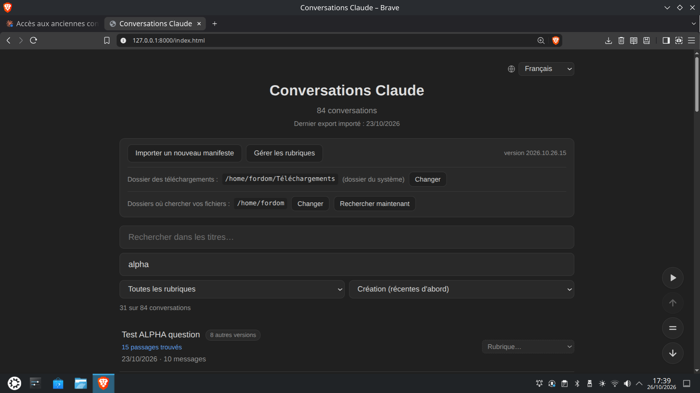

# Claude Export Viewer (wersja 2026.10.26.15)

[English](README.md) | [Français](README.fr.md) | [Español](README.es.md) | [Deutsch](README.de.md) | [Italiano](README.it.md) | [Português](README.pt.md) | [Nederlands](README.nl.md) | **Polski** | [Русский](README.ru.md) | [中文](README.zh.md) | [日本語](README.ja.md) | [한국어](README.ko.md)

Zamień historię rozmów z Claude.ai w lokalną stronę HTML, którą każda przeglądarka otworzy bez połączenia z Internetem, i prowadź narastające archiwum swoich rozmów, łącznie z tymi, które zostały później usunięte z Claude.ai.



Ten projekt opiera się na [claude-export-viewer](https://github.com/lordjabez/claude-export-viewer) autorstwa Judsona Neera, mocno zmienionym i rozbudowanym (zob. „Licencja i podziękowania”).

> Ten projekt jest niezależny i niepowiązany z Anthropic. Claude jest znakiem towarowym Anthropic.

> Został zaprojektowany i przetestowany w systemie Linux Ubuntu 26.04, w Pythonie 3.14 i JavaScripcie. Powinien działać w systemie Windows. Kod został napisany z pomocą Claude (model Opus 5.5, wysoki poziom rozumowania). Ten README jest automatycznym tłumaczeniem wersji francuskiej.

## Szybki start w systemie Linux Ubuntu / Debian

1. Pobierz historię rozmów z claude.ai (interfejs jest po angielsku): **Settings > Privacy > Export data** (Ustawienia > Prywatność > Eksportuj dane). Otrzymasz najpierw e-mail informacyjny, a potem drugi, z linkiem do pobrania pliku „manifest”.

2. Zainstaluj 4 biblioteki i Pandoc w terminalu:  
`sudo apt install python3-jinja2 python3-mistune python3-pydantic python3-pygments pandoc`

3. Zapisz program `claude-export-viewer.zip` w `~/Pobrane`.

4. Rozpakuj go do swojego folderu domowego i uruchom: pliki eksportu zostaną pobrane na podstawie manifestu i zaimportowane, a następnie otworzy się spis.  
`cd ~/Pobrane && unzip -o claude-export-viewer.zip`  
`rm -rf ~/claude-export-viewer && mv claude-export-viewer ~/`  
`cd ~/claude-export-viewer`  
`python3 claude-export-viewer.py ~/Pobrane -o ~/claude_site`  
(Polecenie `rm -rf` usuwa tylko poprzednią wersję programu: Twoje rozmowy są w `~/claude_site`.)

5. Jeden raz utwórz ikonę uruchamiania na pulpicie:  
`python3 claude-export-viewer.py -o ~/claude_site --install-icon`

## Funkcje

- **Ogólny spis** wszystkich rozmów, z:
  - wyszukiwaniem w tytułach, z licznikiem wyników;
  - sortowaniem rozmów: według daty utworzenia, daty ostatniej wymiany, tytułu, liczby wiadomości;
  - własnymi **kategoriami**, wybieranymi w małym menu po prawej stronie każdej rozmowy, do dowolnego filtrowania;
  - **wyszukiwanie w treści** (od 3 liter): zostają tylko rozmowy zawierające wszystkie słowa, z liczbą znalezionych fragmentów; słowo jest szukane w tekście, polecenie takie jak `\alpha` we wzorach, symbol taki jak `α` lub `∞` w obu; wielkość liter i akcenty są pomijane.
- **W każdej rozmowie**:
  - lokalna data i godzina, link **Otwórz w claude.ai** (jeśli rozmowa nadal tam istnieje);
  - sformatowany Markdown (pogrubienie, listy, tabele) i podświetlany kod (Pygments);
  - ramki kodu z nazwą języka i przyciskiem **Kopiuj** (kopiuje dokładny kod do schowka);
  - **wzory matematyczne wyświetlane jak w LaTeX-u** (KaTeX, dołączony, offline): `$…$`, `$$…$$`, `\(…\)`, `\[…\]`; skopiowanie fragmentu kopiuje źródło LaTeX jego wzorów; wzór, którego nie da się wyświetlić, pozostaje jako źródło, z przyczyną w podpowiedzi;
  - wyświetlane artefakty (kod, dokumenty, HTML/SVG pokazywane jako kod, nigdy nie wykonywane);
  - rozumowania, wywołania narzędzi i wyniki w zwijanych blokach;
  - **wiele wersji**: gdy wiadomość została edytowana lub odpowiedź wygenerowana ponownie, strona podąża za wersją prowadzącą do ostatniej wymiany; pozostałe wersje są w zwijanych ramkach „Inna wersja”, w miejscu, w którym rozmowa się rozgałęziła;
  - **eksport do Markdown, LibreOffice (.odt) i Word (.docx) na żądanie**: przycisk „.md” w każdej rozmowie; plik zawiera główny wątek oraz, w ramkach (cytatach) z etykietami kursywą, każdą inną wersję w miejscu jej rozgałęzienia (lub, przy odznaczonym polu, tylko główny wątek); wzory jako `$…$`, kod, artefakty i nazwy załączników (bez rozumowań i wyników narzędzi); do odczytu w Typora, Obsidian, Zettlr, do konwersji przez Pandoc;
  - **eksport do PDF** przez okno drukowania przeglądarki, łącznie ze wzorami;
  - **wyróżnione szukane słowa** po otwarciu z listy, z małym paskiem do przechodzenia między fragmentami;
  - **ukrywanie odpowiedzi Claude'a**, aby widzieć tylko swoje wiadomości jedna pod drugą (mała strzałka po dacie każdej wiadomości, przycisk w prawym górnym rogu dla wszystkich);
  - **kopiowanie wiadomości** w Markdownie, wzory w LaTeX, ikoną obok daty;
  - **nawigacja klawiaturą**: ← i → (4 i 6 wyłączonej klawiatury numerycznej), aby przechodzić między swoimi wiadomościami, 7, 5 i 1 klawiatury numerycznej na górę, środek i dół strony, M do ukrycia odpowiedzi, ? dla listy; te same przyciski po prawej, z **powolnym, ciągłym przewijaniem** o regulowanej prędkości (+ i −);
  - **załączone dokumenty**: pełny tekst (bez ucinania na 3000 znakach), zapisany jako plik i otwierany ikoną w programie komputera; instrukcje dodane automatycznie przez claude.ai są pokazywane tylko raz.
- **Twoje pliki odnalezione**: wysłane przez Ciebie obrazy i pliki, oryginały załączonych dokumentów oraz zapisane pliki utworzone przez Claude'a są szukane po dokładnej nazwie w folderach wybranych na liście (z podfolderami), kopiowane do witryny i pokazywane w rozmowie; przyciski Tak / Nie, aby potwierdzić, że to właściwy plik (oraz Zmień, aby zmienić odpowiedź); brakujące jeszcze pliki są szukane przy każdym uruchomieniu.
- **Narastające archiwum**: kolejne eksporty są dodawane bez duplikatów, a rozmowy usunięte później z claude.ai zostają zachowane.
- **12 języków** (strony, konsola, eksporty), do wyboru w spisie.
- **Ikona na pulpicie** (Linux, Windows), która otwiera spis i jednym kliknięciem importuje nowy eksport.
- Jasny lub ciemny motyw, zgodnie z ustawieniem systemu.

## Instalacja

Rozpakuj ten folder w dowolnym miejscu (dysk, pendrive…), a następnie zainstaluj cztery potrzebne biblioteki.

**Ubuntu / Debian**: zob. „Szybki start” powyżej.

**Windows** (Python 3.11 lub nowszy, z [python.org](https://www.python.org/downloads/) lub ze sklepu Microsoft Store), w terminalu (PowerShell lub Wiersz polecenia):

```
py -m pip install jinja2 mistune pydantic pygments
```

W systemie Windows zamień w poleceniach tego dokumentu `python3` na `py`, a ścieżki `~/…` na ścieżki Windows (`C:\Users\[Użytkownik]\claude_site`, `E:\claude_site` dla pendrive’a…). **Obsługa systemu Windows została napisana na podstawie dokumentacji Pythona i Windows, ale nie została jeszcze wypróbowana na komputerze z Windows**: uwagi są mile widziane.

## Ikona „Archiwum Claude” (najprostszy sposób)

Po pierwszym imporcie (zob. niżej) utwórz jeden raz ikonę:

```
python3 claude-export-viewer.py -o ~/claude_site --install-icon
```

Pojawia się w menu aplikacji i na pulpicie (Linux; KDE może raz poprosić o zaufanie do programu uruchamiającego) albo w menu Start i na pulpicie (Windows: skróty tworzone przez PowerShell, które uruchamiają `pythonw.exe`, więc nie otwiera się okno konsoli; niewypróbowane). Kliknięcie otwiera spis w przeglądarce, udostępniany przez mały lokalny serwer (http://127.0.0.1:8000), który sam się zatrzymuje 30 minut po zamknięciu ostatniej strony (`--idle`, aby zmienić ten czas). Drugie kliknięcie korzysta z już działającego serwera, chyba że uruchomiła go wcześniejsza wersja programu: wtedy zostaje zatrzymany i zastąpiony, aby rzeczywiście używana była nowa wersja. Umieść program w stałym folderze (na przykład `~/claude-export-viewer`) przed utworzeniem ikony.

Otwarty z ikony spis zbiera swoje ustawienia w ramce u góry: przyciski **Importuj nowy manifest** i **Zarządzaj kategoriami**, a pod nimi folder pobranych plików z przyciskiem **Zmień**. Każdy przycisk otwiera swój panel; drugie kliknięcie (lub krzyżyk) go zamyka. Przycisk **Importuj nowy manifest**: po zamówieniu eksportu w claude.ai i kliknięciu linku w e-mailu z informacją, że dane są gotowe, bierze najnowszy manifest z folderu pobranych plików, otwiera linki po kolei (są też wyświetlane, z możliwością kliknięcia, w dzienniku strony), importuje eksport i przeładowuje spis. Zamknięcie dziennika w trakcie importu go nie przerywa: kolejne kliknięcie pokazuje go ponownie.

W tej samej ramce wiersz **Folder pobranych plików** wskazuje, gdzie szukany jest manifest. Jeśli przeglądarka zapisuje pliki gdzie indziej (jej ustawienie „Zapisuj pliki w” lub „Lokalizacja”), kliknij **Zmień** i podaj ten folder: zostanie zapamiętany w archiwum i będzie przeszukiwany jako pierwszy, przed folderem systemowym. Puste pole przywraca folder systemowy; jeśli wybrany folder zniknie (wyjęty pendrive), używany jest folder systemowy.

A w każdej rozmowie eksporty .md, .odt i .docx działają jednym kliknięciem.

**Bezpieczeństwo**: serwer nasłuchuje tylko na Twoim komputerze (127.0.0.1) i nie udostępnia surowego archiwum. Import wymaga „tajnego tokenu”, który mogą odczytać tylko strony spisu, a żądania pochodzące z innej witryny są odrzucane: strona internetowa otwarta w tej samej przeglądarce nie może ich wywołać.

## Wiersz poleceń

1. W claude.ai: **Settings > Privacy > Export data** (Ustawienia > Prywatność > Eksportuj dane).
2. Gdy przyjdzie e-mail, kliknij zawarty w nim link: przeglądarka pobierze mały plik „manifest” (listę plików eksportu i ich linków).
3. Uruchom:

```
python3 claude-export-viewer.py ~/Pobrane -o ~/claude_site
```

Program bierze najnowszy manifest z folderu, a następnie:

- sam otwiera każdy link w Twojej przeglądarce (w której jesteś zalogowany do claude.ai), **po kolei**, czekając na zakończenie każdego pobierania (link może przestać działać po użyciu);
- rozpoznaje już pobrane pliki, nawet jeśli przeglądarka zmieniła ich nazwę (`conversations-000 (1).zip`), i pomija pliki z wcześniejszego eksportu;
- przenosi pliki do `~/claude_site/archive/exports/<data>/`;
- importuje eksport do archiwum i otwiera spis.

Domyślnie pobierane są tylko przydatne pliki (rozmowy, projekty, konto). Opcje:

- `--all`: pobrać wszystkie 7 plików eksportu (pełna kopia zapasowa);
- `--browser brave-browser`: wybrać przeglądarkę, która otwiera linki;
- `--manual`: niczego nie otwierać; linki są wyświetlane po kolei w terminalu (Ctrl + kliknięcie, aby je otworzyć, lub prawy przycisk > kopiuj adres, aby wkleić go w wybranej przeglądarce), a program przechodzi do następnego, gdy tylko plik dotrze;
- `--timeout 600`: czekać do 600 s na każde pobieranie (domyślnie 300, w trybie ręcznym 900);
- `--no-browser`: nie otwierać spisu na końcu;
- `--downloads FOLDER`: zapamiętać folder, w którym przeglądarka zapisuje pobrane pliki (to samo ustawienie co „Zmień” w spisie); `--downloads ""` przywraca folder systemowy. Użyta sama, bez pliku do zaimportowania, opcja zapisuje ustawienie i kończy działanie.

Każda opcja ma też nazwę francuską (`--tout`, `--navigateur`, `--manuel`, `--delai`, `--sans-navigateur`, `--telechargements`…), wyświetlaną przez `--help`.

**Warunek**: być zalogowanym do claude.ai w przeglądarce, która otwiera linki (linki eksportu działają tylko w zalogowanej sesji). W trybie automatycznym każdy link jest też wyświetlany w terminalu: jeśli otworzyła się niewłaściwa przeglądarka, otwórz go we właściwej, program i tak wykryje plik. Ctrl + C kończy działanie w uporządkowany sposób; ponowne uruchomienie tego samego polecenia wznawia pracę od miejsca przerwania.

Przeglądarki: wszystkie, które zapisują w zwykłym folderze pobranych plików (trwające pobierania `.crdownload` w Chrome, Brave, Edge, Opera, Vivaldi, `.part` w Firefoksie, `.download` w Safari), lub w folderze podanym przez `--downloads`. Folder systemowy jest znajdowany przez `xdg-user-dir` w Linuksie i w rejestrze w Windows (nawet jeśli został przeniesiony, na przykład do OneDrive). Przetestowano w Linuksie; macOS i Windows powinny działać, ale nie zostały jeszcze wypróbowane.

Linki wygasają 24 godziny po utworzeniu eksportu; po tym czasie program to zgłasza i przypomina, jak zamówić nowy eksport. Otwierane są tylko linki do `https://claude.ai/` i nie są obsługiwane żadne dane logowania: pobieranie odbywa się w Twojej własnej przeglądarce.

Można też podać bezpośrednio pliki ZIP (lub rozpakowany folder):

```
python3 claude-export-viewer.py ~/Pobrane/conversations-000.zip -o ~/claude_site
```

Rozmowy bez żadnego wymienionego tekstu są pomijane na stronie: tak w eksporcie wyglądają usunięte rozmowy, czasem z pozostałością (obraz lub załączony plik, pusta odpowiedź), która nie liczy się jako tekst. Dodaj `--keep-empty`, aby mimo to je uwzględnić.

## Kategorie

Każda rozmowa może otrzymać wybraną kategorię („matematyka”, „medycyna”, „nauka”…), jedną na rozmowę.

- **Wybór**: gdy spis jest otwarty z ikony, małe menu po prawej stronie każdej rozmowy proponuje istniejące kategorie, „Brak kategorii” oraz **Nowa kategoria…**, aby utworzyć nową (najwyżej 40 znaków; „Mat” i „mat” to ta sama kategoria).
- **Filtrowanie**: gdy tylko istnieje jakaś kategoria, obok pozostałych filtrów pojawia się menu „Wszystkie kategorie”, z pozycją „Bez kategorii” i każdą z kategorii. Łączy się z wyszukiwaniem, pozostałymi filtrami i wszystkimi sposobami sortowania: przy „Wszystkie kategorie” wszystkie rozmowy pozostają widoczne.
- **Zarządzanie**: przycisk **Zarządzaj kategoriami**, obok przycisku importu, pokazuje każdą kategorię z liczbą jej rozmów, aby zmienić jej nazwę (zmiana nazwy na istniejącą kategorię łączy obie) lub ją usunąć (jej rozmowy pozostają, bez kategorii).

Kategorie są zapisywane w archiwum (`archive/topics.json`): podążają za stroną (pendrive, inna przeglądarka) i przetrwają kolejne importy. Otwarty bezpośrednio z `index.html`, bez programu, spis pokazuje kategorie i pozwala filtrować, ale nie pozwala ich zmieniać.

## Gdzie umieścić program i stronę

Folder programu (`claude-export-viewer`) i folder strony (`claude_site`, wybierany przez `-o`) mogą znajdować się w dowolnym miejscu, także na pendrivie:

```
python3 /media/ja/USB/claude-export-viewer/claude-export-viewer.py ~/Pobrane -o /media/ja/USB/claude_site
```

Strona otwiera się potem przez `index.html`, na dowolnym komputerze, nawet bez programu (przycisk importu i eksporty .odt/.docx wymagają programu; eksporty .md i .pdf działają wszędzie). Ikona i polecenia wyświetlane na stronach zapamiętują pełne ścieżki: jeśli pendrive zostanie zamontowany gdzie indziej (inny komputer, inna litera dysku w Windows), utwórz ikonę ponownie z nowego miejsca; strony zostaną zaktualizowane przy następnym imporcie.

## Języki

Program mówi w 12 językach: angielskim, francuskim, hiszpańskim, niemieckim, włoskim, portugalskim, niderlandzkim, polskim, rosyjskim, chińskim (uproszczonym), japońskim i koreańskim.

- **Strony** otwierają się w języku przeglądarki lub po angielsku, jeśli ten język nie jest dostępny. Menu w prawym górnym rogu spisu zmienia jednym kliknięciem język całej strony: spisu, rozmów, dat (w formacie danego kraju), eksportów i dziennika importu. Przeglądarka zapamiętuje wybór.
- **Komunikaty konsoli** są w języku systemu lub w języku podanym w opcji `--lang` (`--langue`): `--lang pl`, `--lang de`…
- **Nazwa ikony** jest w języku sesji („Archiwum Claude” po polsku, „Claude Archives” po angielsku…).
- Same rozmowy nigdy nie są tłumaczone. Kod i wzory są oznaczone tak, aby automatyczne tłumaczenie przeglądarki ich nie zmieniało.

Tłumaczenia inne niż francuskie i angielskie są tłumaczeniami automatycznymi: poprawki są mile widziane. Każdy język to prosty plik tekstowy, `src/claude_export_viewer/i18n/<kod>.json`; zdanie, którego brakuje w danym języku, wyświetla się po angielsku.

## Eksportowanie rozmowy (.md, .odt, .docx, .pdf)

Każda strona rozmowy proponuje „Eksportuj: .md .odt .docx .pdf”, a obok pole **Uwzględnij inne wersje i usunięte części**:

- zaznaczone (domyślnie): eksportowane jest wszystko, inne wersje i usunięte części w wciętych ramkach, w miejscu ich rozgałęzienia;
- odznaczone: eksportowany jest tylko **główny wątek** (ten wyświetlany na stronie), a nazwa pliku kończy się na „(główny wątek)”.

Przeglądarka zapamiętuje ostatni wybór. W wierszu poleceń odznaczonemu polu odpowiada opcja `--main-thread`.

- **.md** działa zawsze, bezpośrednio w przeglądarce.
- **.pdf** także działa zawsze: otwiera okno drukowania przeglądarki, w którym wystarczy wybrać „Zapisz jako PDF”. Wzory wyglądają dokładnie tak jak na ekranie, na białym tle nawet w trybie ciemnym; treść jest taka sama jak w pozostałych formatach (bez rozumowań i narzędzi), a nazwa pliku jest podpowiadana.
- **.odt** (LibreOffice) i **.docx** (Word) przechodzą przez Pandoc, który zamienia wzory LaTeX na prawdziwe, edytowalne wzory. Zainstaluj go jeden raz (zob. „Zależności opcjonalne”). Dwa sposoby użycia:
  - **jednym kliknięciem**, przeglądając stronę przez mały wbudowany serwer lokalny:  
    `python3 claude-export-viewer.py -o ~/claude_site --serve`  
    następnie otwiera się http://127.0.0.1:8000 (Ctrl + C, aby zatrzymać). Serwer jest dostępny tylko z Twojego komputera;
  - **poleceniem**, jeśli strona jest otwarta bez serwera: przycisk pokazuje dokładne polecenie do skopiowania, na przykład  
    `python3 claude-export-viewer.py -o ~/claude_site --odt "Pitagoras"`  
    (tytuł, początek tytułu lub identyfikator; `--export-dir`, aby wybrać, gdzie zapisać plik).

Wzory, których Pandoc nie potrafi przekonwertować, pozostają w dokumencie w postaci LaTeX, a program je zgłasza.

## Narastające archiwum: dodawanie kolejnych eksportów

Każdy eksport z claude.ai to zdjęcie stanu Twojego konta w danym momencie. Folder strony zawiera **archiwum** (`archive/`), które gromadzi wszystkie zaimportowane eksporty. Przy nowym eksporcie wystarczy uruchomić to samo polecenie z tym samym folderem `-o`: przetwarzane są tylko nowe lub zmienione rozmowy.

- **Bez duplikatów**: każda rozmowa jest rozpoznawana po swoim identyfikatorze.
- **Nic nie ginie**: rozmowa usunięta z claude.ai pozostaje w archiwum, z oznaczeniem „Usunięta w claude.ai” w spisie, komunikatem na jej stronie i filtrem, aby je pokazać lub ukryć.
- **Zniknięte wiadomości**: eksport zawiera wszystkie wersje rozmowy (edytowane wiadomości, ponownie wygenerowane odpowiedzi). Gdyby mimo to wiadomości zniknęły z późniejszego eksportu, archiwum je zachowuje i pokazuje na ich miejscu, w ramce „Część usunięta w claude.ai”.
- **Dowolna kolejność**: zaimportowanie starszego eksportu po nowszym uzupełnia archiwum, niczego nie nadpisując.
- **Data każdego eksportu**: program szuka manifestu obok pliku zip (jeśli jest ich kilka, wybiera pierwszy utworzony po najnowszej wiadomości eksportu); w przeciwnym razie przyjmuje datę tej wiadomości. Można ją też podać opcją `--export-date RRRR-MM-DD`.

**Nie usuwaj folderu strony**: `archive/` zawiera kopię Twoich rozmów, także tych, które już nie istnieją w claude.ai. Aby zrobić kopię zapasową, skopiuj ten folder. Aby zaktualizować program, zastąp folder programu, a następnie uruchom polecenie bez eksportu, aby ponownie wygenerować strony:

```
python3 claude-export-viewer.py -o ~/claude_site
```

Przydatne opcje: `--rebuild` (ponownie wygenerować wszystkie strony), `--structure EKSPORT.zip` (pokazuje tylko nazwy pól eksportu, bez żadnej treści: przydatne do zgłoszenia problemu).

Postęp jest wyświetlany co 50 rozmów. Nieczytelne elementy są pomijane i zgłaszane ostrzeżeniem na końcu, bez przerywania przetwarzania.

## Zmiany w stosunku do oryginału

- **Stałe zużycie pamięci**: rozmowy są odczytywane i zapisywane po jednej (strumieniowo), zamiast wczytywania całego eksportu. Zmierzono na fikcyjnym eksporcie 595 MB: najwyżej 57 MB pamięci (oryginał potrzebuje około 4 razy więcej niż rozmiar pliku).
- **Nowy format eksportu**: akceptuje eksport podzielony na kilka plików ZIP, folder lub pliki `.json` / `.jsonl`, niezależnie od ich dokładnej nazwy. Oryginał szukał tylko `conversations.json`, a w przeciwnym razie zgłaszał „0 rozmów” bez błędu.
- **Tolerancja**: nieznany typ treści (obraz, wyszukiwanie w sieci…), nieoczekiwany nadawca, puste pole czy nieczytelna data nie zatrzymują już całego przetwarzania; są wyświetlane w sposób ogólny lub pomijane.
- **Bezpieczeństwo**: linki `javascript:` (i inne niebezpieczne protokoły) są neutralizowane; obrazy przywołane w rozmowie są wyświetlane jako linki, bez ich wczytywania (archiwum pozostaje czytelne offline, bez łączenia się z witrynami zewnętrznymi); eksport .odt / .docx nie może osadzić pliku z komputera.
- **Odporność**: rozmowa, której nie da się wyświetlić, jest zgłaszana i pomijana bez przerywania generowania strony; uszkodzone archiwum daje jasny komunikat; projekt zapisany w kilku wierszach jest rozpoznawany.
- **Podświetlanie kodu**.
- **Wzory LaTeX**: chronione przed Markdownem (znaki `_`, `*` i `\\` we wzorach nie są już psute), a następnie wyświetlane przez KaTeX 0.16.47, dołączony do generowanego folderu (bez potrzeby połączenia). Stopniowe wyświetlanie podczas przewijania: strona z 3000 wzorów otwiera się w mniej niż sekundę; przed drukowaniem lub eksportem do PDF wyświetlane jest wszystko.
- **Przycisk „Kopiuj”** przy każdej ramce kodu (bloki kodu i artefakty), z nazwą języka, jak w claude.ai; przy okazji naprawia podwójny `<code>` dla nieznanych języków.
- **Narastające archiwum** kolejnych eksportów: bez duplikatów, rozmowy usunięte z claude.ai zachowane i oznaczone, usunięte części rozmowy zachowane na swoim miejscu, ponownie generowane są tylko zmienione strony.
- **Prowadzone pobieranie** na podstawie manifestu: linki otwierane po kolei w przeglądarce, czekanie na zakończenie każdego pobierania, pliki odkładane do archiwum, import i otwarcie spisu.
- **Eksport do Markdown** każdej rozmowy, jednym kliknięciem, bez wcześniej utworzonego pliku (treść jest osadzona w stronie, a plik tworzy przeglądarka).
- **Eksport .odt / .docx** przez Pandoc (polecenie `--odt` / `--docx` lub jednym kliknięciem przez lokalny serwer `--serve`); automatyczna poprawka konstrukcji LaTeX odrzucanej przez Pandoc (`\textbf` wewnątrz `\text{…}`).
- **Wielojęzyczność**: 12 języków dla stron, konsoli, eksportów i ikony, z menu języka w spisie.
- **Ikona uruchamiania** (`--install-icon`), lokalny serwer, który sam się zatrzymuje (`--open`), przycisk „Importuj nowy manifest” chroniony tokenem; pole „Uwzględnij inne wersje”, aby eksportować wszystko lub tylko główny wątek.
- **Bez zależności od uv**: program uruchamiający `claude-export-viewer.py` dla systemowego `python3`.
- **Własne kategorie**, z filtrem i zarządzaniem (zmiana nazwy, łączenie, usuwanie), zapisywane w archiwum.
- **Konfigurowalny folder pobranych plików** (spis lub `--downloads`), dla przeglądarki zapisującej gdzie indziej lub pendrive’a.
- **Windows** (nieprzetestowane): folder pobranych plików odczytywany z rejestru, teksty w UTF-8, polecenia `py` z cudzysłowami Windows, skróty w menu Start i na pulpicie.
- **Wyszukiwanie w treści** rozmów, z wyróżnionymi słowami i przechodzeniem między wynikami; słowa, polecenia LaTeX i symbole.
- **Pełne załączone dokumenty** (bez limitu 3000 znaków), otwierane w programie komputera; **Twoje pliki odnalezione** na komputerze i pokazywane w rozmowach.
- **Czytanie**: zwijane odpowiedzi Claude'a, kopiowanie wiadomości, nawigacja klawiaturą i klawiaturą numeryczną, powolne ciągłe przewijanie.

## Zależności opcjonalne

- **Pandoc** (eksporty .odt i .docx; przetestowano z Pandoc 3.7):
  - w systemie Linux Ubuntu: `sudo apt install pandoc`;
  - w systemie Windows: `winget install --source winget --exact --id JohnMacFarlane.Pandoc` (polecenie podane przez [pandoc.org](https://pandoc.org/installing.html));
  - w systemie macOS: `brew install pandoc`.

## Licencja i podziękowania

Wolne oprogramowanie na **licencji MIT** (plik `LICENSE`): możesz je swobodnie używać, kopiować, modyfikować, rozpowszechniać i wykorzystywać, pod jedynym warunkiem zachowania informacji o prawach autorskich, która wymienia jego autorów, oraz tekstu licencji. Jest dostarczane „tak jak jest”, bez żadnej gwarancji: jego autorzy nie odpowiadają za żadne szkody wynikające z jego użycia.

- **Autor pierwotnego projektu**: Judson Neer — [github.com/lordjabez](https://github.com/lordjabez), projekt [claude-export-viewer](https://github.com/lordjabez/claude-export-viewer). Serdeczne podziękowania za tę przejrzystą i dobrze przemyślaną podstawę, bez której ta wersja by nie powstała.
- **Zmiany i uzupełnienia**: fordom.
- **KaTeX** (wyświetlanie wzorów, dołączony): licencja MIT, Khan Academy i współtwórcy, zob. `src/claude_export_viewer/static/katex/LICENSE`.

## Testy

```
sudo apt install python3-pytest      # Windows: py -m pip install pytest
python3 -m pytest tests/ -v          # Windows: py -m pytest tests/ -v
```

Specyfika systemu Windows jest sprawdzana w Linuksie przez symulowanie Windows (`tests/test_windows.py`); zestaw testów nie był jeszcze uruchamiany w Windows. Testy w przeglądarce (`tests/test_topics_browser.py`) wymagają Playwright i Chromium; bez nich są pomijane.
