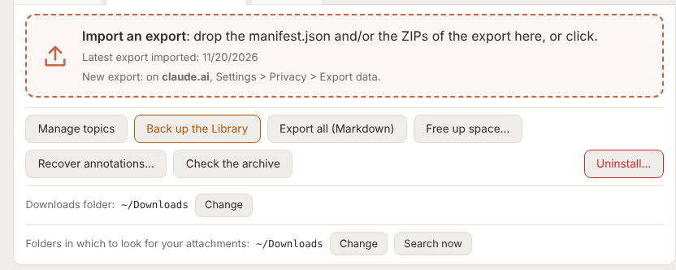
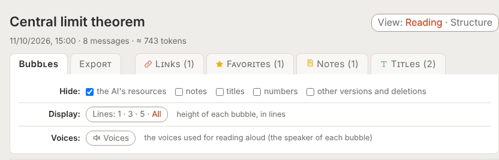

# Claude Export Viewer

[English](README.md) | [Français](README.fr.md) | [Español](README.es.md) | [Deutsch](README.de.md) | [Italiano](README.it.md) | **Português** | [Nederlands](README.nl.md) | [Polski](README.pl.md) | [Русский](README.ru.md) | [中文](README.zh.md) | [日本語](README.ja.md) | [한국어](README.ko.md)

O CEV transforma a exportação das suas conversas do Claude.ai em uma **biblioteca local**: um site que você lê no navegador, sem internet, onde pode pesquisar, anotar, reorganizar e exportar suas conversas. Cada nova exportação se soma às anteriores: nada se perde, nem mesmo o que foi excluído depois no claude.ai.

> Projeto independente, não afiliado à Anthropic. Claude é uma marca da Anthropic. Projetado e testado no Linux (Ubuntu 26.04, Python 3.14); Windows e macOS devem funcionar, mas ainda não foram testados. 12 idiomas.

## Instalação

1. Instale o Python 3 e quatro bibliotecas:
   - Ubuntu / Debian: `sudo apt install python3-jinja2 python3-mistune python3-pydantic python3-pygments`
   - Windows (Python 3.11 ou posterior): `py -m pip install jinja2 mistune pydantic pygments`
2. Descompacte `claude-export-viewer.zip` e clique duas vezes em **Installer CEV** (`.sh` no Linux, `.cmd` no Windows, `.command` no macOS).

O programa é instalado em `~/claude-export-viewer` e cria o ícone **Biblioteca do Claude**. Uma atualização é feita do mesmo jeito, com o novo ZIP: suas conversas nunca são alteradas.

## Primeira importação

1. No claude.ai (site ou aplicativo para computador; não pelos aplicativos para celular): **Configurações > Privacidade > Exportar dados**. Chega um e-mail com um link, válido por 24 horas, que baixa um pequeno arquivo "manifesto".
2. Abra a **Biblioteca do Claude** pelo ícone. Na aba **Gerenciamento de dados**, clique no quadro **Importar uma exportação**: o CEV abre os links da exportação um a um no navegador, importa tudo e mostra suas conversas.

Repita de vez em quando: as novas exportações completam o acervo.

## A Biblioteca: duas partes

A Biblioteca tem duas partes: o **índice**, que lista todas as suas conversas, e a página de cada **conversa**.

## O índice

No alto, o idioma e depois três abas; só uma fica aberta por vez, e um clique na aba aberta a fecha.

**Visão geral**: o número de conversas, mensagens e tokens, o tamanho do site e a atividade semana a semana. **Um clique em uma barra filtra a lista por essa semana.** O bloco do tamanho muda de cor quando um backup é recomendado; um clique leva então ao botão **Fazer backup da Biblioteca**.

**Gerenciamento de dados**: a importação e depois as ferramentas da Biblioteca. **Gerenciar categorias** (renomear, mesclar, excluir); **Fazer backup da Biblioteca** em um ZIP com data; **Exportar tudo** em Markdown, legível sem o CEV; **Liberar espaço** (arquivos que não servem mais); **Recuperar anotações** (o CEV guarda os 5 últimos estados das suas anotações); **Verificar o acervo** (e reparar uma conversa danificada a partir das exportações guardadas); **Desinstalar**, depois de oferecer cópias de tudo.

**Filtros**: pesquisa nos títulos e no conteúdo (texto, fórmulas: `\alpha` ou `α`), com um número de **erros tolerados**; categoria, período e ordenação.

**A lista**: cada conversa com sua data, seu tamanho e suas anotações (favoritos, vínculos, notas). O menu à direita lhe atribui uma **categoria**. Para **vincular** duas conversas, arraste uma sobre a outra.

## A conversa

No alto: o título, com a **Visualização** (Leitura ou Estrutura) à direita. Abaixo, abas fechadas no início; só uma fica aberta por vez, e um clique na aba aberta a fecha.

- **Balões**: **Ocultar** deixa a tela mais leve (recursos da IA, notas, títulos, números, outras versões e exclusões); **Exibição** reduz cada balão a 1, 3 ou 5 linhas; **Vozes** escolhe as vozes da leitura em voz alta. Suas escolhas valem de uma conversa para outra.
- **Exportar**: um arquivo .md, .odt, .docx, .txt ou .pdf, com ou sem suas anotações e as outras versões, em ZIP se quiser.
- **Vínculos**, **Favoritos**, **Notas** e **Títulos** da página: um clique leva até eles.

**Os balões** aparecem como no claude.ai: Markdown, código colorido com botão Copiar, fórmulas matemáticas, artefatos (os programas do Claude rodam na página, offline), documentos anexados completos.

- Depois da data, os ícones do balão: **favorito**, **nota**, **título**, copiar, exportar esta mensagem, o olho (nas suas mensagens: mostrar ou ocultar a resposta do Claude), **ler em voz alta**.
- Antes do nome, o lugar do balão na conversa: `1 ← 2 → 2.1 3` = a pergunta 2 vem depois da 1, tem outra resposta (2.1) e é seguida pela 3. Um clique em um marcador leva até ele.
- **Outra versão**: quando uma mensagem foi editada ou uma resposta gerada de novo, as outras versões continuam legíveis nesses quadros, no seu lugar.
- **Destaque** em 5 cores: selecione um trecho e depois a caneta que aparece ao lado (ou o botão à direita).

Uma conversa muito longa é mostrada em várias páginas ("Parte 2 de 5"), sem nunca separar uma pergunta da sua resposta; a pesquisa na página, a Estrutura e a exportação valem então para a parte mostrada.

**A Estrutura** mostra o esquema da conversa: perguntas numeradas, versões em ramos. Um clique mostra uma pergunta com todas as suas respostas. Você pode **reorganizar a ordem lógica** (arrastar uma pergunta para depois de uma resposta, cortar um ramo, traçar um vínculo lógico em verde) sem mexer na ordem real; "Ordem: real · lógica", na barra da Estrutura, alterna entre as duas.

**As séries**: quando uma conversa continua em outra, abra a aba **Vínculos** e arraste as conversas vinculadas na ordem desejada. Cada página da série mostra então "← anterior · próxima →", no alto e embaixo.

**Os botões à direita**, em dois quadros. No alto: destaque (a roda do mouse escolhe a cor), voltar ao índice, pesquisar na conversa, ocultar ou mostrar todas as respostas do Claude, música de fundo, tema claro ou escuro, página anterior ou seguinte (‹ ›). Embaixo: sua mensagem anterior ou seguinte, a leitura em voz alta de toda a conversa, a **rolagem lenta** (velocidade com a roda do mouse), o início, o meio e o fim da página. O índice tem os mesmos botões, exceto os próprios de uma conversa.

A **leitura em voz alta** usa vozes naturais offline ([Piper](https://github.com/OHF-Voice/piper1-gpl)), instaladas no primeiro uso com o seu consentimento: uma voz para você, uma para o Claude e a voz do idioma de cada parágrafo.

 

## Seus dados

Tudo o que importa está em **`~/claude_site/archive/`**: suas conversas, as exportações originais, suas anotações e suas configurações. Uma conversa excluída no claude.ai continua lá, marcada "Excluída no claude.ai". Para fazer backup, use **Fazer backup da Biblioteca** ou copie esta pasta; para restaurar tudo, solte o backup em uma Biblioteca vazia.

## Linha de comando

Tudo existe também em um terminal (`python3 claude-export-viewer.py`, `py` no Windows); `--help` dá a lista completa.

| Comando | Efeito |
| --- | --- |
| `~/Downloads -o ~/claude_site` | importa a exportação mais recente da pasta |
| `-o ~/claude_site --serve` | abre a Biblioteca |
| `--odt "título"`, `--docx "título"` | exporta uma conversa |
| `--export-all` | todas as conversas em Markdown |
| `--verify`, `--repair` | verifica o acervo, repara o que for possível |
| `--uninstall`, `--restore ZIP` | desinstala, restaura um backup |

## Complementos e licença

O CEV nasceu do [claude-export-viewer](https://github.com/lordjabez/claude-export-viewer) de Judson Neer, a quem agradecemos; desde então foi profundamente transformado e ampliado.

- **Pandoc** para as exportações .odt e .docx: `sudo apt install pandoc` (Windows: `winget install --exact --id JohnMacFarlane.Pandoc`; macOS: `brew install pandoc`).
- **Piper** para a leitura em voz alta: oferecido pelo CEV no primeiro uso (cerca de 200 MB, mais 60 MB por voz).

Software livre sob **licença MIT** (arquivo `LICENSE`), fornecido sem garantia. Incluído: KaTeX (MIT). Instalado à parte a seu pedido: Piper (GPL-3). Testes: `python3 -m pytest tests/`.
