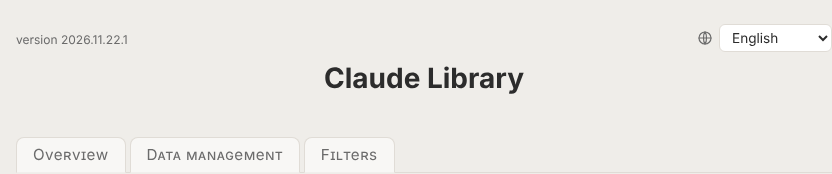

# Claude Export Viewer

[English](README.md) | [Français](README.fr.md) | [Español](README.es.md) | [Deutsch](README.de.md) | [Italiano](README.it.md) | [Português](README.pt.md) | [Nederlands](README.nl.md) | [Polski](README.pl.md) | [Русский](README.ru.md) | **中文** | [日本語](README.ja.md) | [한국어](README.ko.md)

CEV 把你在 Claude.ai 上的对话导出变成一个**本地资料库**：一个无需联网、在浏览器中阅读的网站，你可以在其中搜索、注释、重新组织和导出对话。每次新的导出都会加到之前的导出上：什么都不会丢失，即使后来在 claude.ai 上删除的内容也会保留。

> 独立项目，与 Anthropic 无关联。Claude 是 Anthropic 的商标。在 Linux（Ubuntu 26.04，Python 3.14）上设计和测试；Windows 和 macOS 应该可以运行，但尚未试过。12 种语言。

## 安装

1. 安装 Python 3 和四个库：
   - Ubuntu / Debian：`sudo apt install python3-jinja2 python3-mistune python3-pydantic python3-pygments`
   - Windows（Python 3.11 或更高版本）：`py -m pip install jinja2 mistune pydantic pygments`
2. 解压 `claude-export-viewer.zip`，双击 **Installer CEV**（Linux 用 `.sh`，Windows 用 `.cmd`，macOS 用 `.command`）。

程序会放在 `~/claude-export-viewer`，并创建 **Claude 资料库** 图标。更新方法相同，使用新的 ZIP：你的对话永远不会被改动。

## 第一次导入

1. 在 claude.ai 上（网站或桌面应用；移动应用不行）：**Settings > Privacy > Export data**（设置 > 隐私 > 导出数据）。你会收到一封邮件，其中的链接在 24 小时内有效，会下载一个小的“清单”文件。
2. 通过图标打开 **Claude 资料库**。在 **数据管理** 标签页中，点击 **导入导出文件** 框：CEV 在浏览器中逐个打开导出的链接，全部导入，并显示你的对话。

不时重复一次：新的导出会补充存档。

## 资料库：两个部分

资料库有两个部分：列出所有对话的**目录**，以及每个**对话**的页面。

## 目录

顶部是语言，然后是三个标签页；一次只打开一个，点击已打开的标签页即可关闭它。

**概览**：对话、消息和 token 的数量，网站的大小，以及每周的活动。**点击某个柱形即可把列表筛选到那一周。** 当建议备份时，大小方块会变色；这时点击它会跳到 **备份资料库** 按钮。

**数据管理**：导入，然后是资料库的工具。**管理分类**（重命名、合并、删除）；**备份资料库** 为带日期的 ZIP；**全部导出** 为 Markdown，无需 CEV 即可阅读；**释放空间**（不再需要的文件）；**恢复注释**（CEV 保留注释的最近 5 个状态）；**检查存档**（并用保留的导出修复损坏的对话）；**卸载**，之前会提供所有内容的副本。

**筛选**：在标题和内容中搜索（文字、公式：`\alpha` 或 `α`），可设置**允许的错字**数；分类、时间段和排序。

**列表**：每个对话及其日期、大小和注释（收藏、关联、备注）。右侧的菜单为它指定**分类**。要**关联**两个对话，把一个拖到另一个上。

## 对话

顶部：标题，右侧是 **视图**（阅读或结构）。下面是一开始关闭的标签页；一次只打开一个，点击已打开的标签页即可关闭它。

- **气泡**：**隐藏** 让屏幕更简洁（AI 的资源、备注、标题、编号、其他版本和删除的部分）；**显示** 把每个气泡缩短为 1、3 或 5 行；**语音** 选择朗读的语音。你的选择在各个对话之间保持不变。
- **导出**：.md、.odt、.docx、.txt 或 .pdf 文件，可带或不带注释和其他版本，也可打包为 ZIP。
- 本页的 **关联**、**收藏**、**备注** 和 **标题**：点击即可跳转。

**气泡** 的显示与 claude.ai 上一样：Markdown、带“复制”按钮的彩色代码、数学公式、工件（Claude 的程序在页面中离线运行）、完整的附件文档。

- 日期之后是气泡的图标：**收藏**、**备注**、**标题**、复制、导出这条消息、眼睛（在你的消息上：显示或隐藏 Claude 的回答）、**朗读**。
- 名字之前是气泡在对话中的位置：`1 ← 2 → 2.1 3` = 问题 2 接在 1 之后，有另一个回答（2.1），后面是 3。点击圆点即可跳转。
- **其他版本**：当某条消息被修改或某个回答被重新生成时，其他版本仍在这些框中原位可读。
- **高亮**，5 种颜色：选中一段文字，然后点击旁边出现的笔（或右侧的按钮）。

很长的对话会分成多页显示（“第 2 部分，共 5 部分”），问题和回答永远不会被分开；这时页面内搜索、结构和导出只针对当前显示的部分。

**结构** 显示对话的示意图：编号的问题，版本作为分支。点击会显示一个问题及其所有回答。你可以**调整逻辑顺序**（把问题拖到某个回答之后、剪下一个分支、画一条绿色的逻辑关联），而不改动实际顺序；结构栏中的“顺序：实际 · 逻辑”可在两者之间切换。

**系列**：当一个对话在另一个对话中继续时，打开 **关联** 标签页，把关联的对话拖成想要的顺序。系列中的每一页都会在顶部和底部显示“← 上一个 · 下一个 →”。

**右侧的按钮**，分两个框。上框：高亮（滚轮选择颜色）、返回目录、在对话中搜索、隐藏或显示 Claude 的所有回答、背景音乐、浅色或深色主题、上一页或下一页（‹ ›）。下框：你的上一条或下一条消息、朗读整个对话、**缓慢滚动**（用滚轮调速度）、页面的顶部、中部和底部。目录也有相同的按钮，只是没有对话专用的那些。

**朗读** 使用离线的自然语音（[Piper](https://github.com/OHF-Voice/piper1-gpl)），首次使用时经你同意后安装：一个语音给你，一个给 Claude，另外按每个段落的语言使用相应的语音。

 

## 你的数据

所有重要的内容都在 **`~/claude_site/archive/`** 中：你的对话、原始导出、注释和设置。在 claude.ai 上删除的对话仍保留在那里，标记为“已在 claude.ai 上删除”。要备份，请使用 **备份资料库** 或复制这个文件夹；要全部恢复，把备份拖到一个空的资料库中。

## 命令行

所有功能在终端中也可以使用（`python3 claude-export-viewer.py`，Windows 上用 `py`）；`--help` 给出完整列表。

| 命令 | 作用 |
| --- | --- |
| `~/Downloads -o ~/claude_site` | 导入文件夹中最新的导出 |
| `-o ~/claude_site --serve` | 打开资料库 |
| `--odt "标题"`、`--docx "标题"` | 导出一个对话 |
| `--export-all` | 所有对话导出为 Markdown |
| `--verify`、`--repair` | 检查存档，修复能修复的部分 |
| `--uninstall`、`--restore ZIP` | 卸载，恢复备份 |

## 附加组件与许可

CEV 源自 Judson Neer 的 [claude-export-viewer](https://github.com/lordjabez/claude-export-viewer)，在此向他致谢；此后它已被大幅改造和扩充。

- **Pandoc**，用于导出 .odt 和 .docx：`sudo apt install pandoc`（Windows：`winget install --exact --id JohnMacFarlane.Pandoc`；macOS：`brew install pandoc`）。
- **Piper**，用于朗读：CEV 在首次使用时提供（约 200 MB，每个语音另加 60 MB）。

自由软件，采用 **MIT 许可证**（文件 `LICENSE`），不提供任何担保。已包含：KaTeX（MIT）。应你的要求另行安装：Piper（GPL-3）。测试：`python3 -m pytest tests/`。
